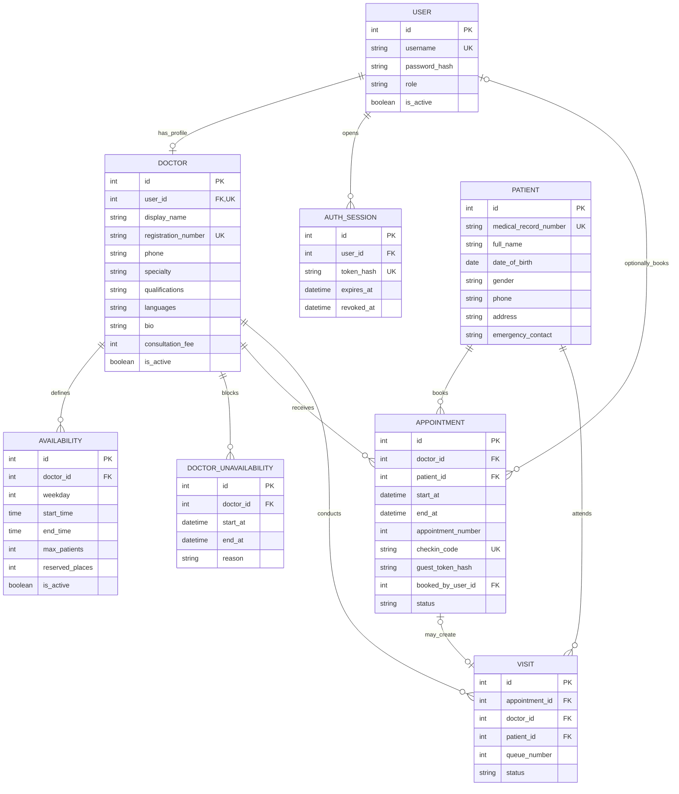

# Medical Clinic Booking and Queue API

A FastAPI backend for public appointment booking and staff-managed clinic queues. Patients can book without creating an account. Optional patient accounts provide access to bookings made while signed in. The repository provides APIs and interactive `/docs`, plus a React web app in [`frontend/`](frontend/README.md) for public booking and the staff portal.

## Scope and privacy

- Public doctor profiles, each day's consulting sessions and the places left in them.
- Guest booking with name and phone number only, alongside doctor and selected session.
- Private booking management using a random token; only its SHA-256 hash is stored.
- Optional patient registration and login; patient accounts never grant staff access.
- Staff login for patient registration, schedules, check-in, walk-ins and queue management.
- A public chat assistant that answers questions about the clinic, doctors' hours and booking. It cannot book or change appointments and never sees patient records.
- Doctors can access only their own appointments and queues; administrators can manage either doctor.
- No prescription, diagnosis, symptom, consultation-note or treatment-plan fields in the booking/queue API or new database schema. Unknown clinical fields are rejected.

Guest bookings create a minimal patient record with no required birth date, gender, address or emergency contact. Staff can still maintain optional demographic/contact information. Names and phone numbers are not treated as proof of identity, and guest submissions never attach themselves to an existing patient record by matching these values.

**Phone verification is not implemented:** no SMS/email provider is configured. A booking management token proves possession of that token, not ownership of a phone number or a medical identity. Keep it private. Before public deployment, integrate contact verification. Login, patient registration, guest booking, guest booking access and the chat assistant are rate limited per client address in the API process (`CLINIC_RATE_LIMIT_ENABLED`); behind a reverse proxy, set `CLINIC_TRUSTED_PROXY_IPS` to its address so each patient is counted separately. Use HTTPS and avoid logging authorization headers, booking tokens or request bodies.

## Technology

- Python and FastAPI
- SQLAlchemy for database access
- PostgreSQL with the Psycopg driver
- [Ollama](https://ollama.com/) running the `llama3.2:1b` model for the chat assistant (optional)

A cloud deployment can be introduced later if the clinic needs to support remote access.

## Run the application locally

### 1. Install Python and PostgreSQL

Install Python 3.14 and confirm that it is available:

```bash
python3 --version
```

Install PostgreSQL and pgAdmin, then start the local PostgreSQL server.

### 2. Create the PostgreSQL databases

The application can create tables only after its PostgreSQL database exists. In pgAdmin, connect to the default `postgres` database and open **Query Tool**. Run each statement separately, replacing the example password with your own password:

```sql
CREATE ROLE clinic_app WITH LOGIN PASSWORD 'change-this-password';
```

```sql
CREATE DATABASE medical_clinic OWNER clinic_app;
```

### 3. Create a virtual environment

Open Terminal in the project folder, then create and activate a virtual environment:

```bash
python3 -m venv .venv
source .venv/bin/activate
```

When the environment is active, `(.venv)` appears at the beginning of the Terminal prompt.

### 4. Install the dependencies

```bash
python -m pip install -r requirements.txt
```

### 5. Create the environment file

Copy the example configuration:

```bash
cp .env.example .env
```

Open `.env`, replace `change-this-password` in the PostgreSQL URL with the password used when creating `clinic_app`, and choose strong initial passwords for the administrator and both doctors. The `.env` file is ignored by Git because it contains database credentials and other secrets. The example sets `CLINIC_DEBUG=true` for local use; with debug off (the default, and the setting for production) the API refuses to start while an initial account password is an example value or shorter than 12 characters.

### 6. Create the tables and start the application

```bash
python main.py
```

At startup, SQLAlchemy connects to `medical_clinic` and creates any missing tables, constraints and relationships from the application models. It also adds the initial administrator and two doctor accounts. The application intentionally accepts only a `postgresql+psycopg://` database URL.

Open these addresses in a web browser:

- Application: http://127.0.0.1:8000
- Interactive API documentation: http://127.0.0.1:8000/docs
- Health check: http://127.0.0.1:8000/api/health

Press `Control+C` in Terminal to stop the application.

### 7. Start the chat assistant model (optional)

The website chat assistant uses a local [Ollama](https://ollama.com/) model. Install Ollama, then download the model:

```bash
ollama pull llama3.2:1b
```

The Ollama desktop app keeps the server running at `http://127.0.0.1:11434`; otherwise run `ollama serve`. The rest of the application works without Ollama. Only chat questions fail, with HTTP 503.

### 8. Start the web app (optional)

With the backend running, open a second Terminal in the `frontend` folder and run `npm install` and then `npm run dev`. Then open http://localhost:5173. See [frontend/README.md](frontend/README.md) for details.

### Load demo data (optional)

For local development, add fictional doctors with specialties and weekly sessions, plus demo patients booked into the next few days:

```bash
python -m app.db.demo_data
```

It also fills in empty profile fields for the two startup doctors, creates each demo doctor account with its password from `CLINIC_DEMO_DOCTOR_PASSWORDS` in `.env`, and is safe to run again. Accounts that already exist keep their passwords. Demo patients use phone numbers starting `070 000 0`. Never run it against a real clinic database.

### Run with PyCharm

Select `.venv/bin/python` as the project interpreter. Create a Python Run Configuration with `main.py` as the script and the project folder as the working directory, then click **Run**. Starting `main.py` also initializes the database automatically.

### Run the tests

Confirm that PostgreSQL is running, then run:

```bash
pytest
```

Tests use `CLINIC_DATABASE_URL` and create a uniquely named temporary PostgreSQL schema. Only that temporary schema is removed after each test; the application's normal tables and clinic data are not changed. Chatbot tests replace the language model with a fake, so Ollama doesn't need to be running.

## Authentication and doctor accounts

The local environment uses these initial usernames:

- Administrator: `admin`
- Doctor One: `doctor1`
- Doctor Two: `doctor2`

Before creating a new database, set `CLINIC_ADMIN_PASSWORD`, `CLINIC_DOCTOR_ONE_PASSWORD` and `CLINIC_DOCTOR_TWO_PASSWORD` in `.env`. There are no initial password defaults in the Python code. These values create missing accounts only and never overwrite passwords for existing accounts.

Log in with `POST /api/auth/login`, then copy the returned access token. In the interactive API documentation, click **Authorize** and enter the token to call protected endpoints. `POST /api/auth/logout` immediately revokes the current token.

Logged-in users can change their password with `PUT /api/auth/password`. They must provide their current password and a new password of at least 12 characters. Administrators can reset another account with `PUT /api/admin/users/{user_id}/password`. A password change or reset revokes all active sessions for that account and requires a new login.

### Permissions

- Administrators can view both doctor profiles, update either profile and activate or deactivate a doctor.
- Administrators can manage working hours and unavailable dates for either doctor.
- Doctors can view doctor profiles and schedules, update their own profile and manage their own schedule.
- Doctors cannot update another doctor's profile or change registration and active-status fields.

### Authentication and doctor APIs

- `POST /api/auth/login` — log in and create a session.
- `POST /api/auth/logout` — log out and revoke the current session.
- `GET /api/auth/me` — return the logged-in account and doctor profile.
- `PUT /api/auth/password` — change the logged-in user's password.
- `PUT /api/admin/users/{user_id}/password` — let an administrator reset a user's password.
- `GET /api/admin/doctors` — list all profiles, including inactive doctors and staff fields (administrator only).
- `GET /api/doctors` — publicly list active doctors: name, registration number, `specialty`, `qualifications`, `languages`, `bio`, `consultation_fee` (rupees, paid at the clinic) and `weekly_sessions` (active weekday, start and end times). Phone numbers are never included.
- `GET /api/doctors/me` — return the logged-in doctor's profile.
- `PATCH /api/doctors/me` — let a doctor update their own profile, including the public fields above. Blank text fields are cleared.
- `GET /api/doctors/{doctor_id}` — publicly return one active doctor profile.
- `PATCH /api/doctors/{doctor_id}` — let an administrator update a doctor profile.

## Staff doctor scheduling

Availability records define a doctor's weekly consulting sessions: weekday, start and end time, `max_patients` (1–200, default 20) and `reserved_places` (default 0), the places kept for walk-ins and reception. Online bookings (guest and patient-account bookings and their reschedules) can fill only `max_patients − reserved_places`. Staff bookings and walk-ins can use every place. There are no fixed times per patient. A booking takes a numbered place in a session and patients are seen in number order. Weekdays use `0` for Monday through `4` for Friday. Unavailability records use `start_at` and `end_at`, so they can block part of a day, a full day or several days.

- `GET /api/doctors/{doctor_id}/availability` — list weekly availability.
- `POST /api/doctors/{doctor_id}/availability` — add an availability period.
- `PUT /api/doctors/{doctor_id}/availability/{availability_id}` — replace an availability period.
- `DELETE /api/doctors/{doctor_id}/availability/{availability_id}` — remove an availability period.
- `GET /api/doctors/{doctor_id}/unavailability` — list unavailable periods.
- `POST /api/doctors/{doctor_id}/unavailability` — add an unavailable period.
- `PUT /api/doctors/{doctor_id}/unavailability/{unavailability_id}` — replace an unavailable period.
- `DELETE /api/doctors/{doctor_id}/unavailability/{unavailability_id}` — remove an unavailable period.
- `POST /api/doctors/{doctor_id}/sessions/cancel` with `{"start_at": "...session start...", "reason": "optional, staff only"}` — cancel one session on one date. It adds time off for the session, cancels its scheduled bookings and any waiting check-ins, and returns the affected patients' numbers, names and phone numbers for staff to contact. It is refused while a patient is with the doctor, or if the session has ended or is already closed.

Bookings cancelled this way have `cancelled_by_clinic: true`. The patient, or staff, can move them to another session through the usual reschedule endpoint. This turns the booking back to `scheduled` with a new number, and places kept for walk-ins are open to it. Patients who had already checked in are rebooked by reception.

## Staff patient management

After logging in, administrators and doctors can:

- Register a patient and receive an automatically generated medical record number.
- Search patients by medical record number, name or phone number.
- View and edit patient details.

Patient management is currently available through these protected REST endpoints:

- `POST /api/patients` — register a patient.
- `GET /api/patients` — list patients or search with the `query` parameter.
- `GET /api/patients/{patient_id}` — return one patient's details.
- `PATCH /api/patients/{patient_id}` — update a patient's details.

## Staff dashboard API

Call `GET /api/dashboard` with an administrator or doctor bearer token. No dashboard HTML page is served.

- Today's appointment list includes patient names, doctors, times and status, sorted by reserved time.
- Summary fields report total appointments, waiting patients, in-progress consultations and completed visits.
- Doctor queues contain only waiting/in-progress visits; completed and cancelled visits leave the active queue.
- Administrators can see all doctors or filter by one doctor. A doctor can see only their own appointments and queue. Patient accounts cannot access dashboard data.
- Quick actions use `POST /api/patients`, `POST /api/appointments`, and `POST /api/visits/walk-in` for registration, booking and walk-ins.
- Each appointment or queue entry includes allowed actions with a label, HTTP method, API path and request body for check-in, start, complete or cancel. The mutation endpoints enforce permissions and check conflicts again.

`GET /api/dashboard` returns a staff-authenticated daily snapshot. Optional `doctor_id` filters the snapshot, subject to the same ownership checks. Responses use `Cache-Control: no-store` and contain no patient phone numbers, clinical fields or booking tokens.

“Today” uses `CLINIC_TIMEZONE` (default `Asia/Colombo`), with an inclusive local midnight and exclusive next midnight. Appointment totals include cancelled/no-show bookings; scheduled, cancelled and no-show subtotals are provided separately. Waiting, in-progress and completed counts refer to visits on that clinic date, including legacy walk-ins without appointments. Empty doctor queues remain visible, including inactive doctors for administrators, so existing work is not hidden.

The dashboard uses existing API endpoints and does not require a schema change beyond the earlier booking upgrade.

## Guest booking

No login is required for these endpoints:

| Endpoint | Purpose |
| --- | --- |
| `GET /api/doctors` | Browse active doctors |
| `GET /api/doctors/{doctor_id}` | View public doctor details |
| `GET /api/doctors/{doctor_id}/sessions?day=2030-01-07` | List the day's sessions with `max_patients`, `remaining` places and `remaining_online` places |
| `GET /api/doctors/{doctor_id}/booking-status?day=2030-01-07` | Check `remaining_places` and `remaining_online_places` across the day |
| `POST /api/guest/appointments` | Book using name, phone, doctor and session |
| `GET /api/live-queue` | Today's sessions: status, the number being seen and the numbers still to be seen. Numbers only, no patient details |

Example guest request. `start_at` is the start of a listed session that has places left:

```json
{
  "doctor_id": 1,
  "start_at": "2030-01-07T09:00:00+05:30",
  "full_name": "Nimal Perera",
  "phone": "+94771234567"
}
```

The response contains `id`, `doctor_id`, the session's `start_at` and `end_at`, the patient's `appointment_number`, `status`, and a one-time-displayed `management_token`. Save the token securely. The API sends `Cache-Control: no-store`. It does not expose the patient ID, contact details or token hash.

Send the token in the `X-Booking-Token` header for:

- `GET /api/guest/appointments/{appointment_id}`
- `PUT /api/guest/appointments/{appointment_id}/cancel`
- `PUT /api/guest/appointments/{appointment_id}/reschedule` with `{"start_at": "...the new session's timezone-aware start..."}`

Tokens are scoped to a single booking and expire 24 hours after its current end time. They cannot retrieve patient records or other bookings. Lost tokens require staff assistance; the API does not recover them using an unverified phone number.

## Clinic contact details

`GET /api/clinic-contact-details` needs no login. It returns the clinic's public contact details, which the website footer displays:

```json
{
  "name": "CareFlow Clinic",
  "address_lines": ["No. 42, Lake View Road", "Colombo 05, Sri Lanka"],
  "phone": "+94 11 234 5678",
  "whatsapp": "+94 77 123 4567",
  "email": "hello@careflowclinic.lk",
  "reception_hours": "Monday to Friday, 8:00 to 18:00",
  "closed_days": "Closed on weekends and public holidays",
  "emergency_number": "1990"
}
```

The details are stored in [`app/content/clinic_contact.json`](app/content/clinic_contact.json), the single source for both the website and the chat assistant. The values shipped with the project are **mock details**. `whatsapp`, `email`, `closed_days` and `emergency_number` are optional (`null` or left out), and unknown fields are rejected. The file is read on each request, so edits apply without a restart.

## Website chat assistant

The public site has an **Ask a question** button that opens a chat assistant. It only answers questions. It cannot book, cancel or reschedule appointments, and it points people to the **Book a visit** and **Manage booking** pages instead.

`POST /api/chatbot/messages` needs no login. Send the conversation so far, ending with the user's question:

```json
{
  "messages": [
    {"role": "user", "content": "When does Doctor One see patients?"}
  ]
}
```

The response is `{"reply": "..."}` with `Cache-Control: no-store`. Each message can be up to 1,000 characters, and a request can hold up to 20 messages. Only `user` and `assistant` roles are accepted, and unknown fields are rejected. If the model can't be reached, the API returns 503.

What the assistant knows:

- The clinic's contact details and reception hours from [`app/content/clinic_contact.json`](app/content/clinic_contact.json). The website footer shows the same details (see [Clinic contact details](#clinic-contact-details)).
- The text in [`app/content/clinic_info.md`](app/content/clinic_info.md): directions, fees, services, facilities and how booking works. **The details in both content files are mock details for development.** Replace them with the clinic's real information before going live. Changes apply to the next question without a restart.
- Active doctors' names, their weekly consultation hours, and their unavailable periods over the next 14 days. These are read from the database for every question. Unavailability reasons and registration numbers are left out.
- Today's date in `CLINIC_TIMEZONE`.

It never sees patient records, appointments, queues or booking codes. Conversations are not stored on the server; the browser keeps them only until the page is closed. The model is told to refuse medical advice and to direct emergencies to emergency services. A small model can still make mistakes, so the chat window says that answers may be wrong.

Configure the model in `.env`:

| Setting | Default | Purpose |
| --- | --- | --- |
| `CLINIC_CHATBOT_BASE_URL` | `http://127.0.0.1:11434` | Ollama server address |
| `CLINIC_CHATBOT_MODEL` | `llama3.2:1b` | Ollama model name |
| `CLINIC_CHATBOT_TIMEOUT_SECONDS` | `60` | Maximum time to wait for an answer |

Each address can ask 15 questions a minute, because every question uses model compute.

## Text messages to patients

Patients get a text when they book or move a booking: the doctor, date, session start, their number and booking ID. On the day of the visit they get a reminder with their number and check-in code. Reminders go out at `CLINIC_SMS_REMINDER_HOUR` (default 7 AM) or `CLINIC_SMS_REMINDER_HOURS_BEFORE` (default 3) hours before the session, whichever is later. No reminder is sent if the booking was made or moved after that time, if the patient has checked in, or if the session starts within 30 minutes.

Each message is written to the `sms_outbox` table in the same transaction as the booking. A background job in the API process runs every `CLINIC_SMS_WORKER_INTERVAL_SECONDS` (default 60). It queues due reminders, then hands queued messages to the provider. Rows are locked while sending, and reminders are unique per booking and session, so running several API processes never sends a message twice. Set `CLINIC_SMS_WORKER_ENABLED=false` to turn the job off.

**No SMS provider is connected yet.** With the default `CLINIC_SMS_PROVIDER=outbox`, messages are recorded but not sent. Administrators can read them under **SMS outbox** in the staff portal, or through `GET /api/admin/sms`. To send for real, add a sender class for the chosen gateway in `app/services/sms.py` and select it with `CLINIC_SMS_PROVIDER`. Phone numbers are stored in `+94` form when they look like Sri Lankan numbers.

## Optional patient accounts

`POST /api/auth/register-patient` accepts only `username` and `password` (at least 12 characters). The server assigns the patient role. Login uses the existing `/api/auth/login` endpoint.

To associate a new booking with the account, include its bearer token when calling `/api/guest/appointments`. Booking without a token remains supported. Existing guest bookings are not automatically claimed through a matching name or phone number.

- `GET /api/my/appointments` returns up to 100 recent bookings made with that account.
- `PUT /api/my/appointments/{appointment_id}/cancel` cancels an owned booking.
- `PUT /api/my/appointments/{appointment_id}/reschedule` moves an owned booking.

Patients can change their password and log out. They cannot use staff patient, scheduling, appointment or queue APIs.

## Staff appointments and queues

`POST /api/appointments` accepts `doctor_id`, `patient_id`, and the timezone-aware `start_at` of a session. It requires an administrator or the assigned doctor. The same permissions apply to reading, cancelling and rescheduling through `/api/appointments/{appointment_id}`.

- `POST /api/appointments/{appointment_id}/check-in` accepts `{}` on the clinic-local appointment date.
- `GET /api/check-in/{code}` (staff only) finds a booking from its `checkin_code`, ignoring case, spaces and dashes. It returns the patient, doctor, number and session, `can_check_in`, and a `problem` such as "This booking is for Tuesday 08 January, not today." Doctors can look up only their own bookings.

Every booking has a random 10-character `checkin_code`. Patients see it as a QR code on the booking confirmation and on their booking tickets. The QR links to `/staff/check-in?code=…`, so reception can scan it with a phone camera, a handheld scanner, or the computer camera from **Scan check-in** on the dashboard. The code is separate from the private management code. On its own it does nothing: the lookup requires a staff login.
- `POST /api/visits/walk-in` accepts `doctor_id` and `patient_id` and gives the patient the next free number in today's earliest open session.
- `GET /api/doctors/{doctor_id}/queue` returns the assigned doctor's queue; optional `day` defaults to the clinic-local date.
- `GET /api/visits/{visit_id}` returns an authorized visit.
- `PATCH /api/visits/{visit_id}` accepts only `status`.
- `POST /api/doctors/{doctor_id}/sessions/arrive` with `{"start_at": "...today's session start..."}` records when the doctor arrived for that session. The first time recorded is kept. Starting the first patient also records it if no one did.
- `POST /api/doctors/{doctor_id}/sessions/leave` with the same body records when the doctor left. It needs a recorded arrival and is refused while a patient is with the doctor. The first time recorded is kept. Until the doctor leaves, the dashboard keeps showing the session even past its scheduled end. The live queue shows the session as running late while patients are still waiting, for up to 2 hours past the end, and as ended once the doctor leaves.

The server records times when each step happens, and they cannot be set through the API. A visit gets `checked_in_at` when the patient joins the queue, `consult_started_at` when it moves to `in_progress`, and `consult_ended_at` when it is completed or cancelled from `in_progress`. The dashboard shows, for each doctor, today's current or next session with `doctor_arrived_at`, and a `seen` list of today's completed visits with their times. The live queue shows `doctor_arrived_at` and `doctor_left_at` as well.

Visits move from `waiting` to `in_progress` to `completed`. Waiting or in-progress visits may be cancelled. Completed/cancelled visits cannot be edited. Completing or cancelling a visit also updates its appointment. Checked-in bookings must be managed through the staff visit workflow.

Each booking gets the lowest number not held in its session, so a cancelled number is given to the next booking. Rescheduling into another session gives a new number; rescheduling into the same session keeps it. Time off that overlaps any part of a session closes the whole session. Queues are ordered by session and then by appointment number, not by arrival. A visit's `queue_number` records check-in order; `appointment_number` is the number the patient was given.

Database row locks serialize booking and queue allocation per doctor. Bookings for a full session return 409, and failed guest bookings do not leave orphan patient records. Cancelled reservations release capacity.

## Existing database upgrade

New installations create the revised schema automatically. Existing installations need this in-place upgrade before running the revised app:

```bash
python -m app.db.initialize
```

This adds guest-token/account ownership columns and makes birth date optional. It also moves older schemas to the current columns: each legacy `doctor_unavailability.unavailable_date` becomes a whole clinic-local day in `start_at`/`end_at`, and the legacy patient `sex` column is copied into `gender`. Sessions that used fixed-length slots get `max_patients` equal to their old slot count, and every session gets `reserved_places` 0. Upcoming slot bookings move to the start and end of their session and are numbered in their old time order. Past and cancelled bookings keep their times. The command is safe to run repeatedly. It preserves existing rows, keeps the legacy columns (no longer required), and does not delete legacy clinical data.

To permanently remove the old clinical columns and their contents after the clinic has authorized their deletion, run:

```bash
python -m app.db.initialize --purge-clinical-data
```

The purge removes appointment `reason` and visit `presenting_complaint`, `diagnosis`, `clinical_notes`, and `treatment_plan`. It is explicit, transactional and repeatable, and does not happen automatically at startup. No prescription tables existed in this implementation; the obsolete planned entities have been removed from the diagram. Existing backups and external copies are outside this command's scope.

## Data model



## Staff workflow APIs

All routes below require a staff bearer token. Doctors can browse and update only their own appointments; account administration requires an administrator.

- `GET /api/appointments`: paginated staff appointment search. Optional filters are `doctor_id`, `patient_id`, `status`, `date_from`, and `date_to`. Dates are inclusive clinic-local dates applied to appointment start times. `offset` defaults to 0; `limit` defaults to 20 and is capped at 100. The response contains `items`, `total`, `offset`, and `limit`, ordered by start time and ID. Without a doctor filter, administrators see all doctors and doctors see only themselves.
- `PUT /api/appointments/{appointment_id}/no-show`: marks an unchecked-in, scheduled appointment as `no_show` after its end time. Repeating the operation is safe. Checked-in, cancelled, or completed appointments return 409. Today's dashboard offers this action for eligible appointments.
- `POST /api/admin/users`: creates a patient, doctor, or administrator account. Supply `username`, `password` (12–128 characters), `role`, and optionally `is_active` (default true). Doctor accounts additionally require `doctor: {"display_name": "Doctor Three", "registration_number": "DOC-003", "phone": "0771234567"}`; phone is optional. Usernames and registration numbers must be unique.
- `GET /api/admin/users`: lists accounts with optional `role` and `is_active` filters and the same pagination defaults and response envelope as appointment search. Password hashes and session tokens are never returned.
- `GET /api/admin/users/{user_id}`: reads an account and its optional doctor profile.
- `PATCH /api/admin/users/{user_id}`: changes `role` and/or `is_active`. Assigning the doctor role to an account without a profile requires the nested `doctor` object described above. Existing profiles are retained for appointment/visit history, disabled when the account leaves the doctor role, and reactivated when it returns. Edit existing profile details through the doctor endpoints. Role/activity changes revoke existing sessions; reactivation requires a fresh login. The last active administrator cannot be demoted or disabled, including through concurrent requests. Startup seeding preserves account administration changes.

Schedule edits now reject conflicts with HTTP 409. A session with ongoing or future scheduled bookings cannot be removed, disabled, moved to another weekday or start time, or limited below the highest number already booked. Changing only its end time or raising its limit is allowed, and the session's bookings take the new end time. Adding or moving an unavailable period cannot overlap such bookings. Resolve the bookings first through rescheduling, cancellation, or visit management. Schedule mutations share the doctor's booking lock, so a concurrent booking and conflicting schedule edit cannot both succeed. Historical and terminal bookings do not prevent schedule edits.

These additions use the existing database schema and need no database migration.
