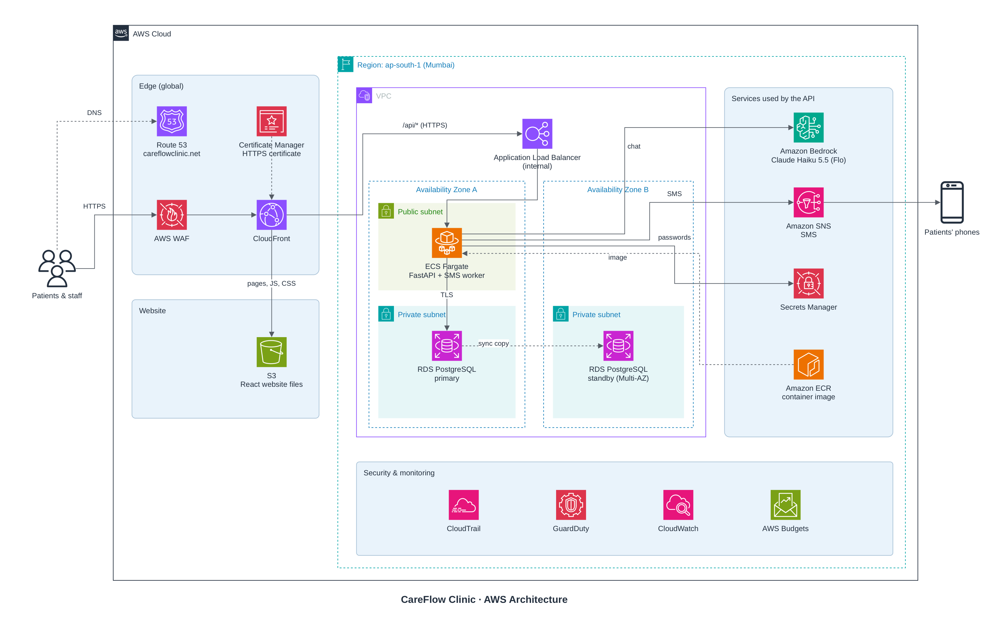

# AWS Deployment

All AWS resources are created by code in this folder (AWS CDK, Python). Put AWS credentials in `infra/.env` and run `./deploy.sh`.

Region: **ap-south-1 (Mumbai)**, closest to Sri Lanka. Domain: **careflowclinic.net**.

## Architecture



To change the diagram, edit [`architecture/architecture.drawio`](architecture/architecture.drawio) in draw.io, export it as `architecture.pdf`, then convert it to `architecture.png` from inside `architecture/`: `qlmanage -t -s 2800 -o . architecture.pdf && mv architecture.pdf.png architecture.png`

## Services

| Part | Service | Choice |
| --- | --- | --- |
| Website | S3 + CloudFront | Static files, free HTTPS |
| Domain + certificates | Route 53 + ACM | `careflowclinic.net`, `www` redirects to it |
| API | ECS Fargate | 1 ARM task, 0.25 vCPU / 0.5 GB |
| API routing | Application Load Balancer | Internal; only CloudFront can reach it |
| Database | RDS PostgreSQL 17 | `db.t4g.micro`, Multi-AZ, 20 GB (grows to 100 GB) |
| Chat assistant | Bedrock | Claude Haiku 5.5, pay per message |
| SMS | SNS | Pay per message |
| Images | ECR | CDK's image repository, built for ARM on deploy |
| Secrets | Secrets Manager | Passwords generated by code |
| Monitoring | CloudWatch | Alarms emailed to `ALERT_EMAIL` |
| Cost alert | AWS Budgets | Email at 80% and 100% of the budget |
| Network | VPC, 2 AZs | No NAT Gateway (saves ~$35/month) |

The website certificate and WAF rules are in us-east-1, because CloudFront requires it; everything else is in Mumbai.

## Security

- **WAF:** blocks common web attacks, bad IPs and request floods.
- **GuardDuty:** detects leaked keys and unusual database logins, and emails an alert.
- **CloudTrail:** records every action in the AWS account (kept 1 year).
- **Secrets Manager:** holds all passwords (listed under Services).
- **Settings in code:**
  - HTTPS everywhere, and TLS to the database.
  - Database, files, secrets and logs encrypted at rest (AWS-managed keys).
  - The database and load balancer are private.
  - The API has the minimum permissions it needs.
  - Containers run as non-root with a read-only file system.
  - Browser security headers are added.
  - The database has deletion protection.

## Backups

| Backup | Kept | Cost |
| --- | --- | --- |
| RDS automated backups | 35 days, restore to any second | Free |
| Final snapshot when removing the system | Until deleted by hand | Free |

Multi-AZ keeps a standby database for failover; it is not a backup. Data is never deleted automatically.

## Monthly cost (estimate)

| Item | USD |
| --- | --- |
| RDS Multi-AZ | 33 |
| Load balancer | 18 |
| WAF | 9 |
| Fargate | 7 |
| Public IPv4 | 4 |
| GuardDuty | 2–5 |
| CloudTrail, Secrets, CloudWatch, ECR, S3, CloudFront | 3–4 |
| Route 53 | 0.50 + yearly domain fee |
| Bedrock (~1,000 chat messages) | < 1 |
| SNS | per SMS |
| **Total** | **~$77–82 + SMS** |

## Setup

Copy `.env.example` to `.env` and fill in the AWS keys, `HOSTED_ZONE_ID` and `ALERT_EMAIL`. The other values are already set.

Needed on your computer: Docker (running, to build the API image), Node.js 22 or 24 (LTS), Python 3.14.

One-time manual steps:

1. Turn on MFA for the root account.
2. Create an IAM user with MFA for the keys above (not root keys).
3. Register `careflowclinic.net` in Route 53, then copy its hosted zone ID into `.env`.
4. Confirm the alert email from AWS.
5. For SMS: register the sender ID (e.g. `CareFlow`) for Sri Lanka and request SMS production access. Until approved, messages stay in the outbox.

## Deploy

```bash
cd infra
./deploy.sh      # create or update everything
./destroy.sh     # remove everything (final DB snapshot kept)
./cdk.sh diff    # any other CDK command, e.g. preview changes before deploying
```

The scripts install the pinned CDK tool and Python packages inside `infra/` on first run.

`deploy.sh` prints the site URL and the names of the three secrets holding the initial admin, doctor1 and doctor2 passwords (open them in Secrets Manager > Retrieve secret value).

`destroy.sh` asks you to type `DELETE`, turns off the database's deletion protection, then removes all stacks. The final database snapshot, automated backups and audit logs are kept.

## Implementation

| Step | What | Status |
| --- | --- | --- |
| 1 | CDK project and scripts | Done |
| 2 | Security stack | Done |
| 3 | Network and database stacks | Done |
| 4 | App changes for AWS | Done |
| 5 | API stack | Done |
| 6 | Edge and website stacks | Done |
| 7 | Monitoring stack | Done |
| 8 | First deployment (`./deploy.sh`) | To do |
| 9 | Bedrock chat assistant | To do |
| 10 | SNS SMS sender | To do |

Each step is checked with `cdk synth`, which builds the CloudFormation templates locally without contacting AWS. Nothing exists in AWS until step 8.

Every resource is tagged `Project=CareFlow`. Paths below are relative to the repository root.

### 1. CDK project and scripts

| File | Change |
| --- | --- |
| `infra/app.py` | New. Entry point that creates every stack (one per layer). |
| `infra/config.py` | New. Reads settings from `infra/.env` and stops with a clear message if `DOMAIN_NAME`, `HOSTED_ZONE_ID` or `ALERT_EMAIL` is missing. |
| `infra/cdk.sh` | New. Behind every command: loads `.env`, installs the tools inside `infra/` on first run (Python packages in `.venv/`, CDK CLI in `node_modules/`), builds the React app if missing, then runs the CDK command. |
| `infra/deploy.sh` | New. Builds the React app, bootstraps CDK in both regions (one-time), deploys all stacks. |
| `infra/destroy.sh` | New. Asks you to type `DELETE`, turns off the database's deletion protection, removes all stacks. |
| `infra/.env.example` | New. Template for `infra/.env` (never committed). |
| `infra/cdk.json` | New. Tells CDK how to run `app.py`, plus CDK's recommended settings for new projects. |
| `infra/package.json`, `package-lock.json` | New. Pin the CDK CLI to 2.1145.0. |
| `infra/requirements.txt` | New. Pins aws-cdk-lib 2.273.0 and constructs 10.8.1. |
| `infra/.gitignore` | New. Keeps `node_modules/` and `cdk.out/` out of git. |
| `.dockerignore` | Excludes `infra/` so `infra/.env` (AWS keys) is never sent to a Docker build. |

### 2. Security

| File | Change |
| --- | --- |
| `infra/stacks/__init__.py` | New, empty. Makes `stacks/` a Python package. |
| `infra/stacks/security.py` | New. `CareFlow-Security` stack: an SNS alert topic emailing `ALERT_EMAIL`; CloudTrail for all regions, logs in a private encrypted bucket for 365 days with file validation (bucket kept after `destroy.sh`); GuardDuty with RDS login monitoring, emailing medium and high findings (severity 4+) in plain words. |
| `infra/cdk.json` | Turns on CDK's recommended HTTP → HTTPS redirect for CloudFront. |

### 3. Network and database

| File | Change |
| --- | --- |
| `infra/stacks/network.py` | New. `CareFlow-Network` stack: VPC in `ap-south-1a` and `ap-south-1b` (named directly, no account lookup), each with a public and a private subnet, no NAT Gateway; private subnets have no internet route. Security groups for the load balancer, API and database; the database accepts only the API on 5432. The default security group is locked down. |
| `infra/stacks/database.py` | New. `CareFlow-Database` stack: PostgreSQL 17 `db.t4g.micro`, Multi-AZ, 20 GB gp3 growing to 100 GB, encrypted, private subnets, TLS required (`rds.force_ssl`), password generated into Secrets Manager, 35-day backups at 00:30–01:30 Sri Lanka time (kept if the database is deleted), maintenance Sundays 02:00–02:30, deletion protection, final snapshot on removal. |
| `infra/destroy.sh` | Turns off deletion protection before removing the stacks. |

### 4. App changes

| File | Change |
| --- | --- |
| `app/core/config.py` | New settings `CLINIC_DATABASE_HOST`, `_PORT`, `_NAME`, `_USER`, `_PASSWORD`: when a host is set, the database URL is built from these parts (special characters escaped). `CLINIC_DATABASE_SSL_MODE` adds `sslmode` (e.g. `require`). `CLINIC_CLIENT_ADDRESS_HEADER` names the header holding the visitor's IP. All off by default. |
| `app/services/rate_limit.py` | New `client_address()`: uses the configured header when set, otherwise the connection's address. A header sent by a client is ignored unless the setting is on. |
| `main.py` | Passes the header setting to the rate limiter. |
| `tests/test_health.py` | Tests the URL built from parts (password with `@ : /`, TLS mode) and that the local URL is unchanged. |
| `tests/test_authentication_and_doctors.py` | Tests reading the address from the header (IPv4 and IPv6) and ignoring it when the setting is off. |

### 5. API

| File | Change |
| --- | --- |
| `infra/stacks/api.py` | New. `CareFlow-Api` stack: image built from the root `Dockerfile` for ARM; 1 Fargate task (0.25 vCPU / 0.5 GB) in a public subnet for outgoing traffic only, read-only file system except `/tmp`; new version starts before the old one stops, failed updates roll back. Internal load balancer, HTTPS 443 (TLS 1.2/1.3) as `origin.careflowclinic.net` with its own certificate, health check on `/`. App settings: debug off, Sri Lanka timezone, database TLS, `X-Viewer-Address`. Database login and three generated initial passwords (admin, doctor1, doctor2) from Secrets Manager. Logs in CloudWatch for 3 months. |
| `infra/stacks/network.py` | Load balancer → API rules removed; CDK adds them when it connects the two (AWS rejects duplicates). |
| `infra/config.py`, `infra/.env.example` | New required `HOSTED_ZONE_ID`, for the certificates and DNS records. |
| `.dockerignore` | Excludes `demo-video/` from image builds. |

### 6. Edge and website

| File | Change |
| --- | --- |
| `infra/stacks/edge.py` | New. `CareFlow-Edge` stack in us-east-1 (required by CloudFront): certificate for `careflowclinic.net` and `www`; WAF with a limit of 2,000 API requests per 5 minutes per visitor, plus AWS's IP reputation, common attack and known-bad-input rules. |
| `infra/stacks/website.py` | New. `CareFlow-Website` stack: private encrypted S3 bucket for the React build, uploaded with a cache clear on every deploy. CloudFront with TLS 1.2+, HTTP → HTTPS, edge locations including India; `/api/*` goes privately to the load balancer over HTTPS, never cached, 60-second timeout. Functions redirect `www`, send app pages such as `/staff` to the React app, and write the visitor's IP into `X-Viewer-Address`. Security headers: HSTS, Content Security Policy, no framing, no MIME sniffing, strict referrer. The load balancer accepts HTTPS only from CloudFront's own security group. IPv4 and IPv6 DNS records for both domains. |
| `infra/build-frontend.sh` | New. Builds the React app into `frontend/dist`. |
| `infra/stacks/network.py` | The two Availability Zones are fixed in the stack, so synth needs no AWS lookup. |
| `app/core/config.py`, `app/services/rate_limit.py`, tests, `infra/stacks/api.py` | Header changed from `CloudFront-Viewer-Address` to `X-Viewer-Address` with a plain IP: forwarding CloudFront's header would also forward `Host`, which breaks the HTTPS name check. |

### 7. Monitoring

| File | Change |
| --- | --- |
| `infra/stacks/monitoring.py` | New. `CareFlow-Monitoring` stack: 7 alarms emailed through the alert topic when they go off and when resolved (below), and an AWS budget for the whole bill at `MONTHLY_BUDGET_USD`, emailing at 80% and 100%. |
| `infra/stacks/api.py` | Exposes the target group for the ApiDown alarm. |

| Alarm | When |
| --- | --- |
| ApiDown | No healthy API container for 3 minutes |
| ApiErrors | Over 10 server errors per 5 minutes, 3 times in a row |
| ApiCpuHigh / ApiMemoryHigh | Above 80% / 85% for 15 minutes |
| DatabaseCpuHigh | Above 80% for 15 minutes |
| DatabaseStorageLow | Under 2 GB free |
| DatabaseMemoryLow | Under 100 MB free for 15 minutes |

### Still to do

- **Step 8:** fill in `.env`, do the one-time manual steps, start Docker, run `./deploy.sh`.
- **Step 9:** a Bedrock chat model beside Ollama (`CLINIC_CHATBOT_PROVIDER`), with permission to call Claude Haiku 5.5 only.
- **Step 10:** an `SnsSender` beside `OutboxOnlySender` (`CLINIC_SMS_PROVIDER=sns`), turned on once AWS approves SMS.

## Later

- **Staff two-factor login:** staff accounts can see patient records.
- **Data retention policy:** agree with the clinic how long records are kept (Personal Data Protection Act).
- **More traffic:** scale Fargate up first. Running more tasks needs the rate limiter and SMS worker moved out of the API process.
